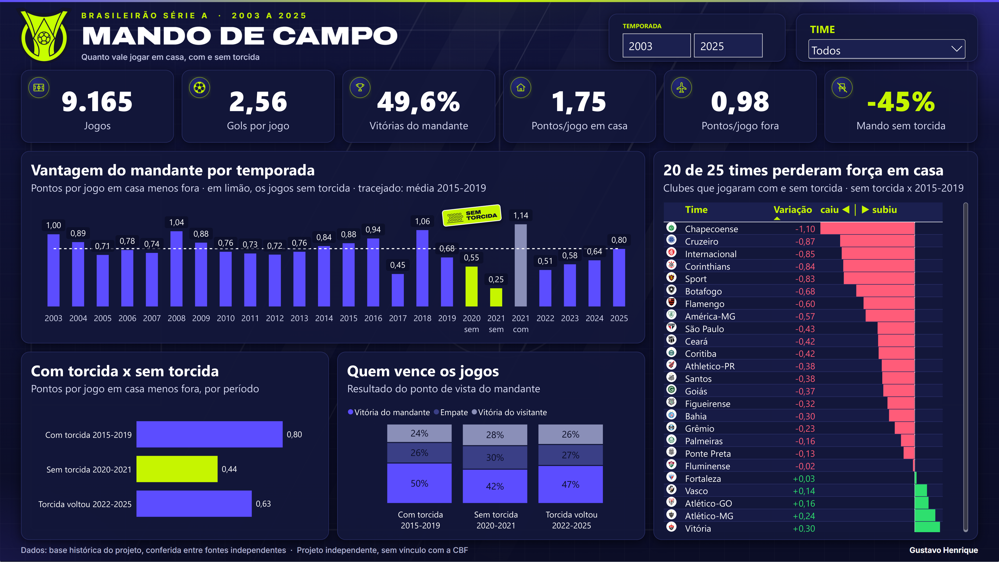

# Painel Power BI: mando de campo



Uma página (1920 x 1080) sobre a base histórica da Série A de 2003 a 2025:
cartões de KPI, a vantagem do mandante por temporada com os jogos sem torcida
em limão, a comparação com torcida x sem torcida, quem vence os jogos por
período e, na coluna da direita, 25 clubes que jogaram com e sem torcida,
cada um contra ele mesmo (escudo, número e barra na mesma linha). Filtros de
temporada e de time.

A tabela por time junta os 21 clubes que estavam na Série A com e sem torcida
e 4 tradicionais que passaram o período sem torcida na Série B (Cruzeiro,
Vitória, Figueirense e Ponte Preta; para eles, Série A 2015-2019 contra Série
B sem torcida). Por isso o título da tabela diz "20 de 25". Os números
principais (0,44 sem torcida, -45%) e a conferência "17 de 21" usam só a Série
A, porque para os 4 muda a divisão junto com a torcida.

Tudo é gerado por script, em texto versionado (PBIP: modelo em TMDL,
relatório em PBIR). Nenhum número é digitado à mão: todo valor sai de uma
medida DAX, e as medidas são conferidas contra o SQL e contra
`analise/resultados_fase1.json`.

## Como gerar

```powershell
.venv\Scripts\python dashboards\powerbi\exportar_dados.py      # marts -> dados\*.csv
.venv\Scripts\python dashboards\powerbi\arte\gerar_arte.py     # fundo, título, adesivo, ícones
.venv\Scripts\python dashboards\powerbi\gerar_pbip.py          # Brasileirao.pbip
```

Abra `Brasileirao.pbip` no Power BI Desktop e clique em Atualizar. Com o
arquivo aberto, confira os números:

```powershell
.venv\Scripts\python dashboards\powerbi\tools\conferir_painel.py
```

## Decisões

- **CSV, não conexão direta com o Postgres.** O relatório abre em qualquer
  máquina sem login de banco. O parâmetro `PastaDados` guarda o caminho da
  pasta `dados\` desta máquina; em outra máquina, troque o parâmetro.
- **Um time em um jogo por linha** (`jogos_time.csv`, duas linhas por jogo).
  É o que deixa o filtro de time valer para todos os visuais: com um time
  escolhido, "vantagem do mandante" vira a força daquele time em casa contra
  fora.
- **As medidas de período ignoram o filtro de temporada** e respeitam o de
  time. A comparação "com x sem torcida" não muda quando alguém mexe no
  slider de anos.
- **Cores por medida.** Limão é sempre sem torcida, violeta é com torcida. A
  paleta segue a identidade de transmissão do campeonato (navy, limão,
  violeta).
- **Arte desenhada no próprio projeto** (`arte/gerar_arte.py`): fundo, título,
  adesivo e ícones em SVG renderizados para PNG. A logo do campeonato entra se
  o arquivo `arte/png/logo_brasileirao.png` existir; o projeto é independente,
  sem vínculo com a CBF, e o rodapé diz isso.

- **Escudos e logo ficam fora do Git.** São marcas dos clubes e do campeonato;
  `arte/baixar_escudos.py` baixa da Wikipédia em português (imagem principal
  de cada clube, origem em `arte/escudos/fontes.csv`) e da Wikimedia Commons
  (logo). Da logo fica só o escudo: o nome do patrocinador, uma casa de
  apostas, é cortado. Na tabela, cada escudo vai num círculo branco para os
  escuros não sumirem no fundo.

## O que custou tempo (para não repetir)

- **Rótulo de dado não cresce além do que a barra comporta.** Pôr 28 ou 40 no
  tamanho não muda nada em barra fina. A saída foi mudar o desenho: "Quem
  vence os jogos" virou colunas largas.
- **Cor por medida em gráfico combinado:** com `metadata` no seletor o Desktop
  ignora; só com `dataViewWildcard` funciona.
- **Imagem em SVG na tabela saiu minúscula.** Ficou a barra de dados nativa
  (`columnFormatting.dataBars`), numa coluna à parte do número, para a barra
  verde não cobrir o texto.
- **Exportar PDF logo depois de aplicar alterações externas** pode sair com os
  visuais encolhidos no canto. Ajuste à página e exporte de novo.

## Conferência

Em 23/10/2026, com o arquivo aberto: as 11 medidas principais (jogos, gols por
jogo, vitórias do mandante, pontos em casa e fora, vantagem geral, 2015 a 2019,
sem torcida, variação, times que caíram e times comparados) bateram com
`analise/resultados_fase1.json` e com contas feitas no CSV exportado das marts.
`tools/conferir_painel.py` faz a mesma conferência contra o SQL quando o
Postgres está no ar.

Em 24/10/2026, com os tradicionais da Série B: `conferir_painel.py` passou nas
17 conferências (as 11 de antes, "20 de 25" na tabela e a variação de cada um
dos 4 clubes contra `tradicionais_serie_b` do JSON).
