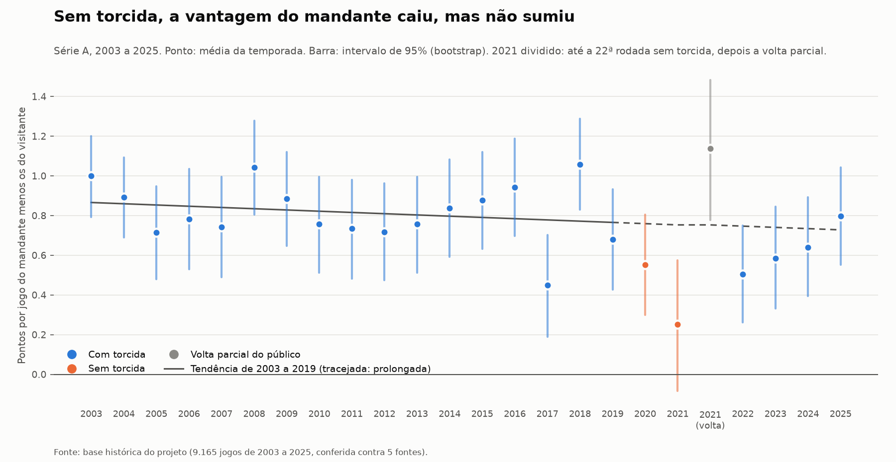
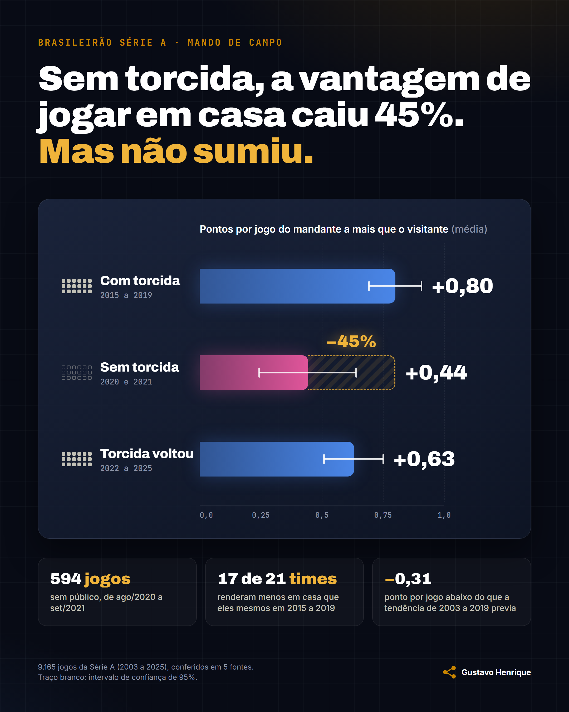

# Fase 1: sem torcida, o mando de campo sumiu?

**Não sumiu, mas caiu quase pela metade.** Nos 594 jogos da Série A sem
público (agosto de 2020 a setembro de 2021), o mandante fez em média 0,44
ponto por jogo a mais que o visitante. Em 2015 a 2019, com torcida, eram 0,80.
A queda é de 0,36 ponto por jogo (intervalo de 95%: 0,13 a 0,58), cerca de 45%.

Card para o post (1080 x 1350), gerado por `analise/card_fase1.py` a partir
do mesmo JSON, sem número digitado à mão. O script para antes de desenhar se
o intervalo sem torcida tocar o zero ou se a queda deixar de ser clara, porque
aí o título do card estaria errado.

## Os números

Denominador de todas as taxas: jogos disputados no período.

| Período | Jogos | Mandante vence | Empate | Visitante vence | Pontos por jogo (mandante / visitante) | Vantagem em pontos (IC 95%) | Saldo médio do mandante (IC 95%) |
|---|---|---|---|---|---|---|---|
| Com torcida, 2003 a 2019 | 6.885 | 50,7% | 26,0% | 23,3% | 1,78 / 0,96 | 0,82 (0,76 a 0,88) | 0,55 (0,51 a 0,59) |
| Com torcida, 2015 a 2019 | 1.899 | 50,3% | 26,1% | 23,6% | 1,77 / 0,97 | 0,80 (0,69 a 0,91) | 0,50 (0,44 a 0,57) |
| **Sem torcida** | **594** | **42,4%** | **30,0%** | **27,6%** | **1,57 / 1,13** | **0,44 (0,24 a 0,64)** | **0,27 (0,15 a 0,39)** |
| Volta parcial (out. a dez. 2021) | 166 | 56,0% | 25,9% | 18,1% | 1,94 / 0,80 | 1,14 (0,78 a 1,48) | 0,55 (0,33 a 0,77) |
| Com torcida, 2022 a 2025 | 1.520 | 47,2% | 26,7% | 26,1% | 1,68 / 1,05 | 0,63 (0,51 a 0,75) | 0,42 (0,34 a 0,50) |

"Vantagem em pontos" = pontos do mandante menos pontos do visitante, por jogo.
Vitória do mandante vale +3, empate 0, vitória do visitante -3.

Sem torcida, o mandante perdeu 0,20 ponto por jogo (1,77 para 1,57) e o
visitante ganhou 0,16 (0,97 para 1,13). A vitória do mandante caiu de 50,3%
para 42,4% (intervalo de 95% sem torcida: 38,4% a 46,5%).

## Por que dá para confiar na queda

A comparação simples poderia enganar de três jeitos. Cada um foi testado:

| Possível engano | Checagem | Resultado |
|---|---|---|
| O mando já vinha caindo, e a pandemia só pegou a tendência | Reta ajustada na vantagem de 2003 a 2019 (cai 0,006 por ano) e projetada para 2020 e 2021 | Esperado 0,76, observado 0,44: 0,31 abaixo da tendência (0,08 a 0,55) |
| Os times da Série A mudam de um ano para outro | Cada time contra ele mesmo: pontos por jogo em casa menos fora, sem torcida contra 2015 a 2019 (21 times nos dois períodos) | 17 dos 21 times caíram; a diferença média é de 0,81 para 0,43, queda de 0,38 (0,23 a 0,54) |
| Jogos da mesma rodada não são independentes | Bootstrap reamostrando rodadas inteiras em vez de jogos | Queda continua clara: intervalo de 0,12 a 0,59 |

O saldo de gols conta a mesma história: o saldo médio do mandante caiu de 0,50
para 0,27 gol por jogo (queda de 0,23; intervalo de 0,10 a 0,37).

## O que não dá para afirmar

- **Que o mando "voltou ao normal" depois.** De 2022 a 2025 a vantagem ficou em
  0,63, abaixo dos 0,80 de 2015 a 2019 (diferença de 0,17, intervalo de 0,00 a
  0,33, no limite). Mas está dentro do que a tendência de longo prazo previa
  (0,11 abaixo dela, intervalo de -0,11 a 0,32). E a diferença entre sem torcida
  e 2022 a 2025 (0,19) não é clara: o intervalo vai de -0,05 a 0,42.
- **Que a volta parcial teve mando mais forte.** Os 1,14 de outubro a dezembro
  de 2021 vêm de 166 jogos, com intervalo de 0,78 a 1,48, e de fim de
  temporada. Não sustenta conclusão.
- **Uma temporada sozinha.** 2017 teve torcida e ficou em 0,45, o mesmo nível de
  2020 (0,55). A conclusão vem do período inteiro e das checagens acima, não de
  um ponto do gráfico.
- **O porquê.** Sem torcida mudaram outras coisas ao mesmo tempo: calendário
  apertado em 2020, cinco substituições, protocolos de viagem. A análise mostra
  que o mando caiu quando a torcida saiu, não isola a torcida como única causa.
  Arbitragem (cartões e pênaltis por mando) é uma pergunta natural para depois;
  a base adaoduque tem cartões por jogo.

## Como o período sem torcida foi definido

Pela data, em `dbt/seeds/periodos_torcida.csv`:

| Período | Datas | Por quê |
|---|---|---|
| Com torcida, antes | até 31/07/2020 | Temporadas 2003 a 2019 |
| Sem torcida | 01/08/2020 a 30/09/2021 | Temporada 2020 inteira e 2021 até a 22ª rodada |
| Volta parcial | 01/10/2021 a 31/12/2021 | A CBF liberou público a partir da 23ª rodada de 2021, com limite de capacidade e exceções (Bahia; clubes paulistas só depois de 04/10) |
| Com torcida, depois | 2022 a 2025 | Temporadas completas com público |

Os dados confirmam o corte: o público da ESPN é zero em todos os jogos de 2020 e
de 2021 até setembro, e aparece a partir de 02/10/2021. A única exceção é
Chapecoense x Palmeiras, em 18/09/2021, com 115 pessoas registradas, que fica
no período sem torcida (um teste em aviso no dbt mostra esse jogo). As exceções
de outubro caem na volta parcial, que fica fora da comparação principal.

## Método

- Fonte: `marts.mando_jogos` (um jogo por linha, com o período), construída
  sobre a base da Fase 0. Datas já corrigidas.
- Intervalos de 95% por bootstrap (10.000 reamostragens, semente 2027); na
  checagem contra a tendência, 2.000 reamostragens, reamostrando jogos dentro de
  cada temporada e refazendo a reta.
- Script: `analise/fase1_mando.py`. Ele confere as médias de cada período
  contra `marts.mando_por_periodo` (a mesma conta feita em SQL) e para se
  houver diferença. Todos os números deste documento estão em
  `analise/resultados_fase1.json`.

## Números para o post e onde conferir

| Número | Onde conferir |
|---|---|
| 594 jogos sem torcida | `periodos.sem_torcida.jogos` no JSON; `marts.mando_por_periodo` |
| Vantagem 0,80 (2015 a 2019) e 0,44 (sem torcida) | `periodos.com_torcida_2015_2019` e `periodos.sem_torcida`, campo `vantagem_pontos` |
| Queda de 0,36, cerca de 45%, intervalo 0,13 a 0,58 | `diferencas_vantagem_pontos.sem_torcida_menos_2015_2019` |
| Vitória do mandante 50,3% para 42,4% | `taxa_vitoria_mandante` nos dois períodos |
| 17 de 21 times caíram | `mesmo_time.times_com_queda` e `mesmo_time.times` |
| 0,31 abaixo da tendência | `contra_tendencia.periodos.sem_torcida` |
| 9.165 jogos, 5 fontes | Fase 0, `docs/conferencia.md` |

**Não usar:** os 0,82 de 2003 a 2019 como "antes" no título (a comparação justa
é com 2015 a 2019, mesma época); os 1,14 da volta parcial como "o mando voltou
mais forte"; "o mando voltou ao normal" para 2022 a 2025.
